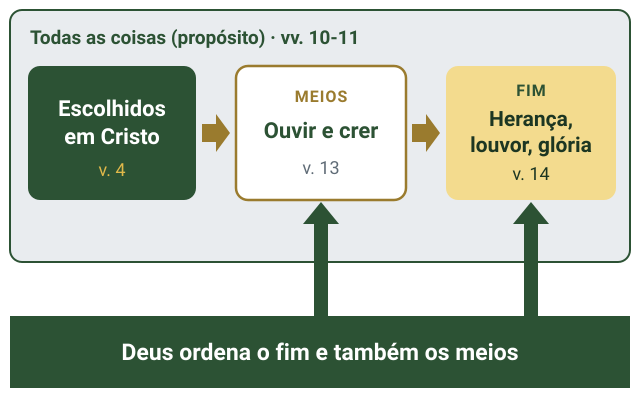
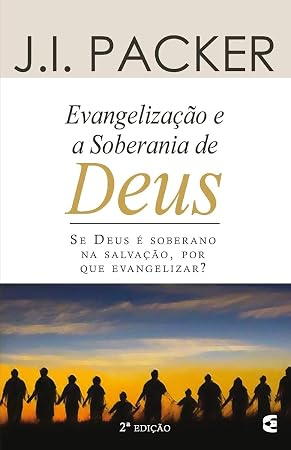
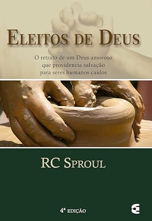
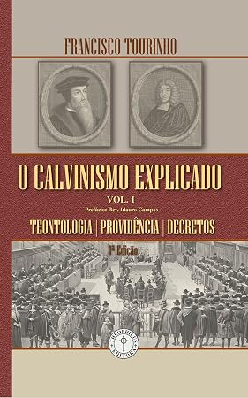

## 1. Abertura

> **Se Deus governa todas as coisas, que lugar têm nossas decisões, o sofrimento, a oração e a fé?**

Não é um tema fácil, e não cabe numa aula só. Por isso a Aula 3 foi dividida em duas partes, e esta página traz, no fim, um material de aprofundamento. O objetivo é ter uma noção de como a doutrina se desenvolveu, saber onde consultá-la, como aprofundar o estudo e que diferença ela faz na vida.

O caminho da aula:

1. **Efésios 1**, o propósito de Deus em Cristo;
2. **o que confessamos**, no Breve Catecismo e na Confissão;
3. **as objeções** mais comuns;
4. **a aplicação** à vida cristã;
5. **o resumo**.

Nesta primeira parte, lemos Efésios 1 e começamos o que confessamos. Efésios 1 foi escolhido porque é um texto comum entre as confissões reformadas quando tratam deste assunto.

## 2. Efésios 1.3-14: o propósito de Deus em Cristo

### Versículos 3 a 6: escolhidos em Cristo

> "Bendito o Deus e Pai de nosso Senhor Jesus Cristo, que nos tem abençoado com toda sorte de bênção espiritual nas regiões celestiais em Cristo, assim como **nos escolheu, nele, antes da fundação do mundo, para sermos santos** e irrepreensíveis perante ele; e em amor **nos predestinou** para ele, **para a adoção de filhos**, por meio de Jesus Cristo, segundo o beneplácito de sua vontade, **para louvor da glória de sua graça**, que ele nos concedeu gratuitamente no Amado."
>
> Efésios 1.3-6, Almeida Revista e Atualizada

O parágrafo começa com louvor: "Bendito o Deus e Pai". **Paulo não abre um debate; ele adora.** Quem age é Deus. Tudo acontece "em Cristo", "nele", "no Amado". E tudo termina "para louvor da glória de sua graça". Paulo não explica *como* Deus escolhe; começa agradecendo *porque* escolheu. **Antes de perguntar como Deus escolhe, o texto nos ensina a bendizê-lo porque escolheu.**

Algumas expressões do trecho:

- **"Nas regiões celestiais"** (ou simplesmente "nos celestiais"): as bênçãos são celestiais na origem. Vieram do céu para os santos e crentes que estão na terra.
- **"Em Cristo"**: os destinatários são o que são por causa da sua união com Cristo (veja Ef 1.1: "aos santos que vivem em Éfeso e fiéis em Cristo Jesus").
- **"Nos"**: Paulo fala de si e dos destinatários da carta e, por extensão, dos que depois ouviriam e creriam. Nada no texto indica que ele esteja falando de toda a humanidade.
- **"Antes da fundação do mundo"**: fomos escolhidos em Cristo antes do tempo, e as bênçãos decorrem dessa [[eleicao|eleição]].
- **"Para sermos santos"**: Deus não nos escolheu *porque* éramos santos, mas *para que* fôssemos santos.
- **"Nos predestinou"**: aqui, praticamente sinônimo de "nos escolheu".
- **"Adoção de filhos"**: a [[adocao|adoção]] nos dá um novo nome, uma nova condição legal e uma nova família. E Deus nos dá um novo espírito, de filhos.
- **"Beneplácito de sua vontade"**: o bem-querer de Deus, sua boa vontade, segundo o seu propósito. É a mesma ideia de Filipenses 2.13: "Deus é quem efetua em vós tanto o querer como o realizar, **segundo a sua boa vontade**".
- **"Para louvor da glória de sua graça"**: Deus nos escolheu para sermos santos e, em última instância, para a sua glória. Tudo é para a glória de Deus.
- **Graça "concedida gratuitamente"**: sem merecimento, sem um preço cobrado de nós. O preço foi cobrado dele próprio e pago na cruz.
- **"No Amado"**: Deus é amor e amou eternamente o Filho. É nele que somos aceitos.

Lembre a Aula 1: há uma só aliança, com [[administracao-da-alianca|administrações]] e sinais visíveis diferentes, debaixo do mesmo propósito divino e administrada soberanamente por Deus em nosso favor. Efésios 1 mostra a raiz eterna dessa aliança.

### Três indicações no versículo 4

> "assim como nos escolheu, **nele**, **antes da fundação do mundo**, **para sermos santos e irrepreensíveis** perante ele"
>
> Efésios 1.4

1. **Em Cristo.**
2. **Antes da fundação do mundo.**
3. **Para a santidade**, que é a finalidade da escolha.

**A graça vem antes da nossa história.** E a vida santa aparece como **finalidade** da escolha, não como sua **causa**. Por isso a doutrina não autoriza nem o orgulho nem a indiferença diante do pecado.

### Predestinados para a adoção

No versículo 5, os crentes foram predestinados:

- "para a adoção de filhos";
- "por meio de Jesus Cristo";
- "segundo o beneplácito de sua vontade".

**O motivo está na boa vontade de Deus, não em algo que ele tenha visto em nós.** E o alvo é uma relação: **sermos filhos**. Paulo fala de pessoas acolhidas em Cristo e chamadas a viver diante de Deus. O propósito que ele descreve nos conduz à gratidão, à santidade e ao louvor.

### Versículos 7 a 10: o propósito revelado em Cristo

> "no qual temos **a redenção, pelo seu sangue, a remissão dos pecados**, segundo a riqueza da sua graça, que Deus derramou abundantemente sobre nós em toda a sabedoria e prudência, **desvendando-nos o mistério da sua vontade**, segundo o seu beneplácito que propusera em Cristo, de **fazer convergir nele**, na dispensação da plenitude dos tempos, **todas as coisas**, tanto as do céu como as da terra"
>
> Efésios 1.7-10

- **v. 7: redenção pelo sangue, remissão dos pecados.** Redenção é libertação, resgate. Ela vem pelo sangue de Cristo, e de novo não por mérito nosso. **A escolha eterna não dispensa a cruz; ela se realiza por meio da cruz.**
- **v. 8: sabedoria e prudência.** Deus age com toda a sabedoria e discernimento.
- **v. 9: o mistério da sua vontade desvendado.** O propósito de Deus não é um segredo inteiramente fechado. **O seu centro foi revelado em Cristo.**
- **v. 10: todas as coisas convergem em Cristo.** Tudo tem Cristo no centro: "Todas as coisas foram feitas por intermédio dele, e, sem ele, nada do que foi feito se fez" (Jo 1.3). A "plenitude dos tempos" começa com a vinda de Cristo, como se os tempos chegassem à maioridade.

### Versículos 11 a 14: todas as coisas e os meios

> "nele, digo, no qual fomos também feitos herança, predestinados segundo o propósito daquele que **faz todas as coisas conforme o conselho da sua vontade**, a fim de sermos para louvor da sua glória, nós, os que de antemão esperamos em Cristo; em quem também vós, **depois que ouvistes a palavra da verdade**, o evangelho da vossa salvação, **tendo nele também crido**, fostes selados com o Santo Espírito da promessa; o qual é **o penhor da nossa herança**, até ao resgate da sua propriedade, em louvor da sua glória."
>
> Efésios 1.11-14

- **Herança.** Um herdeiro recebe algo sem tê-lo merecido. **O que determina o nosso destino não é a sorte nem o mérito humano**, mas o propósito de Deus: maior que nós, sábio, bom e justo.
- **Dica de leitura.** "A fim de sermos para louvor da sua glória" abrange dois grupos. Identifique-os: **nós**, os judeus, que esperávamos o Messias (v. 12); e **vós**, os gentios, que ouviram e creram nele (v. 13). Os dois existem para louvor da glória de Deus.
- **O selo do Espírito.** Os que creram foram marcados e autenticados, como uma carta recebe o selo de quem a envia. São marcados com a santidade de Deus.
- **O penhor.** É a primeira parcela da herança, um adiantamento do que ainda vamos receber. E, novamente, tudo termina "em louvor da sua glória".

O versículo 11 amplia o nosso olhar: Deus "faz todas as coisas conforme o conselho da sua vontade". A salvação é o assunto central do parágrafo, mas está dentro de um propósito que abrange todas as coisas. **Guarde a expressão "conselho da sua vontade"**: o Breve Catecismo vai usá-la para definir o decreto.

No versículo 13 aparecem **ouvir o evangelho** e **crer**, e depois o selo do Espírito. A escolha eterna não elimina o que acontece na história. **A fé é o meio de receber Cristo, não um mérito que leva Deus a escolher.**

**Deus ordena o fim e também os meios.** Voltaremos a esse ponto na Parte 2, quando perguntarmos por que evangelizar e orar.

### Pai, Filho e Espírito

Repare na sequência do parágrafo:

| | O que o texto destaca | Versículos |
|---|---|---|
| **O Pai** | escolhe e predestina para a adoção | 4-5 |
| **O Filho** | redenção e remissão dos pecados | 7 |
| **O Espírito** | sela os que ouvem e creem; é o penhor da herança | 13-14 |

E um refrão atravessa tudo: **"para louvor da sua glória"** (vv. 6, 12 e 14). Essa sequência acompanha as ênfases do texto, sem separar a ação das pessoas da Trindade.

## 3. O que confessamos

### Primeiro, o limite

Antes das definições, um limite.

> "As coisas encobertas pertencem ao SENHOR, nosso Deus, porém **as reveladas nos pertencem**, a nós e a nossos filhos, para sempre, **para que cumpramos** todas as palavras desta lei."
>
> Deuteronômio 29.29

O versículo divide o assunto em duas partes:

| Encobertas: pertencem ao SENHOR | Reveladas: pertencem a nós |
|---|---|
| O motivo de cada acontecimento | **As promessas** |
| Quem são os eleitos | **Os mandamentos** |
| O desfecho de cada história | **O evangelho de Cristo** |

O revelado nos é dado "para que cumpramos". **O conhecimento se volta para a obediência.**

Nós, que gostamos de estudar teologia, podemos confundir **conhecer uma doutrina** com **explicar todos os seus mecanismos**. Podemos conhecer verdadeiramente o que Deus revelou, sem conhecer tudo o que ele conhece nem explicar tudo o que ele faz.

### Depois, as definições

O [[catecismo|Breve Catecismo]] de Westminster (BCW), um dos [[padroes-de-westminster|Padrões de Westminster]] adotados pela IPB, define o assunto em três respostas:

> "Os decretos de Deus são o seu eterno propósito, **segundo o conselho da sua vontade**, pelo qual, para sua própria glória, Ele predestinou tudo o que acontece."
>
> Breve Catecismo de Westminster, resposta 7

> "Deus executa os seus decretos nas obras da criação e da providência."
>
> Breve Catecismo de Westminster, resposta 8

> "As obras da providência de Deus são a sua maneira muito santa, sábia e poderosa de **preservar e governar** todas as suas criaturas, **e todas as ações delas**."
>
> Breve Catecismo de Westminster, resposta 11

- O **[[decreto]]** é o propósito eterno de Deus.
- A **criação** e a **[[providencia|providência]]** são a execução do decreto.
- A providência inclui **preservar** e **governar**. A existência e a ação das criaturas dependem continuamente de Deus, e a resposta 11 inclui "todas as ações delas".
- A **[[predestinacao|predestinação]]**, no sentido particular, diz respeito ao destino eterno dentro desse propósito. O Breve Catecismo trata dela na resposta 20:

> "Tendo Deus, unicamente pela sua boa vontade desde toda a eternidade, **escolhido alguns para a vida eterna**, entrou com eles em um pacto de graça, para os livrar do estado de pecado e miséria, e trazer a um estado de salvação por meio de um Redentor."
>
> Breve Catecismo de Westminster, resposta 20

**Atenção aos dois sentidos de "predestinar".** Na resposta 7, o Catecismo diz que Deus "predestinou tudo o que acontece": é o **sentido amplo**, que abrange todas as coisas. Nesta aula, quando dizemos "predestinação", usamos o **sentido particular** da resposta 20: a escolha para a vida eterna. As duas formulações não se contradizem; falam em escalas diferentes.

### Leitura final

> "nos predestinou para ele, para a adoção de filhos, **por meio de Jesus Cristo**, segundo o beneplácito de sua vontade, **para louvor da glória de sua graça**, que ele nos concedeu gratuitamente **no Amado**"
>
> Efésios 1.5-6

### Na Parte 2

Na próxima aula continuamos com a Confissão de Fé (III.I) e passamos às objeções mais comuns ("somos robôs?", "Deus é o autor do pecado?", "por que orar e evangelizar?"), à aplicação e ao resumo.

**Antes de perguntar como Deus escolhe, Efésios nos ensina a bendizê-lo porque escolheu: em Cristo, antes da fundação do mundo, para sermos santos e para louvor da sua glória.**

---

## Para aprofundar

*Daqui em diante, o conteúdo **vai além do que foi dito em sala**.* É material para quem quiser estudar mais: a pergunta sobre Judas que surgiu na aula, alguns pontos de Efésios 1, um pouco da história da doutrina, onde encontrar o assunto na Confissão e nos catecismos, e perguntas frequentes.

### Pergunta da turma: Judas foi predestinado a trair Jesus?

A pergunta é justa e toca no ponto mais delicado do tema. A Bíblia fala bastante de Judas, e o que ela diz permite responder com firmeza a algumas coisas e pede silêncio sobre outras.

**O que a pergunta quer dizer.** Vimos que "predestinar" tem dois sentidos. No sentido amplo (BCW 7), a pergunta é: *a traição estava dentro do propósito eterno de Deus?* No sentido particular (BCW 20), é outra: *Judas estava destinado à perdição?* As respostas estão ligadas, mas não são idênticas.

**A traição não pegou Deus de surpresa.** O próprio Jesus fala dela como algo determinado:

> "Porque o Filho do Homem, na verdade, **vai segundo o que está determinado**, mas **ai daquele por intermédio de quem ele está sendo traído!**"
>
> Lucas 22.22

Jesus a apresenta como cumprimento da Escritura, citando o Salmo 41.9: "é, antes, para que se cumpra a Escritura: Aquele que come do meu pão levantou contra mim seu calcanhar" (Jo 13.18). Na oração sacerdotal, diz que nenhum dos discípulos se perdeu "exceto o filho da perdição, para que se cumprisse a Escritura" (Jo 17.12). João registra que "Jesus sabia, desde o princípio, quais eram os que não criam e quem o havia de trair" (Jo 6.64). Pedro diz que "convinha que se cumprisse a Escritura que o Espírito Santo proferiu anteriormente por boca de Davi, acerca de Judas" (At 1.16). E, no Pentecostes, que Jesus foi "entregue pelo determinado desígnio e presciência de Deus" (At 2.23). **No sentido amplo, a resposta é sim.** A traição estava dentro do propósito de Deus e serviu ao maior bem da história: a cruz.

**Judas fez o que quis.** Nada nos Evangelhos mostra um Judas arrastado contra a própria vontade:

- Ele era ladrão e tirava dinheiro da bolsa dos discípulos (Jo 12.6).
- Foi ele quem procurou os sacerdotes: "Que me quereis dar, e eu vo-lo entregarei? E pagaram-lhe trinta moedas de prata" (Mt 26.15).
- Lucas diz que "Satanás entrou em Judas", mas em seguida mostra o próprio Judas agindo: ele "foi entender-se com os principais sacerdotes", "concordou e buscava uma boa ocasião" (Lc 22.3-6). A ação de Satanás não apaga a decisão de Judas.
- Jesus o advertiu à mesa (Mt 26.21-25) e, no Getsêmani, ainda o chamou de "Amigo" (Mt 26.50).

E Jesus disse: "**ai daquele** por intermédio de quem ele está sendo traído". Um "ai" desses só faz sentido se a culpa é real. A Confissão de Westminster afirma as duas coisas no mesmo parágrafo: Deus ordenou tudo quanto acontece, "porém de modo que **nem Deus é o autor do pecado, nem violentada é a vontade da criatura**" (CFW III.I). É o texto com que começamos a Parte 2.

**O mesmo ato, intenções opostas.** Agostinho (354-430) chamou a atenção para um detalhe: o Novo Testamento usa o mesmo verbo, "entregar", para o Pai, para o Filho e para Judas. O Pai "não poupou o seu próprio Filho, antes, por todos nós o entregou" (Rm 8.32). O Filho "a si mesmo se entregou por mim" (Gl 2.20). E Judas propôs aos sacerdotes: "eu vo-lo entregarei" (Mt 26.15). Agostinho pergunta:

> "Se o Pai entregou o Filho, e o Filho entregou a si mesmo, o que fez Judas? Houve entrega da parte do Pai, houve entrega da parte do Filho, houve entrega da parte de Judas: uma só coisa foi feita. Mas o que distingue o Pai que entrega o Filho, o Filho que entrega a si mesmo e o discípulo Judas que entrega o seu mestre? **O Pai e o Filho fizeram isso por amor; Judas fez isso por traição.**"
>
> Agostinho, *Comentário à Primeira Epístola de João*, tratado 7, §7

É o mesmo padrão da história de José: "Vós, na verdade, intentastes o mal contra mim; porém Deus o tornou em bem" (Gn 50.20). **Um único acontecimento, dois propósitos: o de Deus, que é bom, e o do homem, que é mau.**

E o bom resultado não absolve o culpado. Calvino, comentando a história de José, usa justamente o exemplo de Judas:

> "Pois de que adiantou a Judas que a redenção do mundo procedesse da sua traição perversa? [...] As ações dos homens não devem ser avaliadas pelo resultado, mas pela medida em que faltaram ao seu dever, ou tentaram algo contrário ao mandamento divino."
>
> João Calvino, comentário a Gênesis 45.8 (tradução nossa)

Deus tirou o maior bem do pior crime, e isso não tornou o crime menos culpado. **O decreto não é a regra da nossa conduta; o mandamento é.**

**E o destino eterno de Judas?** Aqui entramos no sentido particular, e é preciso cuidado. A Escritura chama Judas de "filho da perdição" (Jo 17.12). Jesus diz dele: "Melhor lhe fora não haver nascido!" (Mt 26.24). E os apóstolos dizem que ele "se transviou, indo para o seu próprio lugar" (At 1.25). O Novo Testamento não registra arrependimento de Judas.

A Confissão ensina que, além da eleição para a vida, há um decreto a respeito dos demais, que a teologia chama de [[reprovacao|reprovação]]:

> "Segundo o inescrutável conselho da sua própria vontade, pela qual ele concede ou recusa misericórdia, como lhe apraz, para a glória do seu soberano poder sobre as suas criaturas, o resto dos homens, para louvor da sua gloriosa justiça, foi Deus servido não contemplar e ordená-los para a desonra e ira **por causa dos seus pecados**."
>
> Confissão de Fé de Westminster III.VII

Três observações ajudam a ler isso direito:

1. **Não há simetria.** Os eleitos são salvos por pura graça, *apesar* do seu pecado. Os demais são condenados *por causa* do seu pecado. Deus não pôs maldade em Judas, porque ele "a ninguém tenta" (Tg 1.13). Deus não concedeu a Judas a graça que não devia a ninguém e o julgou pelo que Judas quis e fez.
2. **Escolhido não é o mesmo que eleito para a vida.** Jesus disse: "Não vos escolhi eu em número de doze? Contudo, um de vós é diabo" (Jo 6.70). Judas foi escolhido para o apostolado. Teólogos reformados, como Turretini, distinguem essa escolha para um ofício da [[eleicao|eleição]] para a salvação. Judas andou com Jesus, ouviu seus ensinos, viu seus milagres e foi enviado com os outros onze (Mt 10.1-5). Mesmo assim, não creu (Jo 6.64). **Estar perto de Cristo não substitui a fé em Cristo.** É o que a Aula 1 chamou de estar ligado à aliança por fora sem possuir por dentro o que ela promete.
3. **O assunto pede prudência.** A Confissão diz que esse "alto mistério" deve ser tratado "com especial prudência e cuidado" (CFW III.VIII). Sabemos o que sabemos de Judas porque a Escritura revelou. De nenhuma outra pessoa sabemos isso, e não nos cabe adivinhar (Dt 29.29).

**Pedro e Judas.** Na mesma noite, dois discípulos falharam: um traiu, o outro negou três vezes. Judas, "tocado de remorso", devolveu as moedas e disse "Pequei, traindo sangue inocente". Depois saiu e se enforcou (Mt 27.3-5). Pedro, quando "o Senhor [...] fixou os olhos em Pedro", "saindo dali, chorou amargamente" (Lc 22.61-62). E o Senhor ressuscitado o restaurou, perguntando três vezes "tu me amas?" (Jo 21.15-17).

> "Porque a tristeza segundo Deus produz arrependimento para a salvação, que a ninguém traz pesar; mas a tristeza do mundo produz morte."
>
> 2 Coríntios 7.10

A diferença entre os dois não foi o tamanho do pecado. **O remorso de Judas o afastou de Cristo; a tristeza de Pedro o trouxe de volta a Cristo.**

**"E se eu for um Judas?"** Quem faz essa pergunta com temor normalmente não está tramando trair Cristo, está com medo de perdê-lo. A resposta não está em descobrir um decreto oculto (Dt 29.29), mas na promessa revelada:

> "Todo aquele que o Pai me dá, esse virá a mim; e **o que vem a mim, de modo nenhum o lançarei fora**."
>
> João 6.37

**Em resumo:**

- No sentido amplo, sim: a traição estava dentro do propósito de Deus, que a usou para a nossa redenção.
- Judas, porém, não foi forçado. Agiu por cobiça, por vontade própria e com culpa real, e o bom resultado não o absolveu.
- Quanto ao seu destino eterno, a Escritura indica a perdição, e a Confissão a atribui ao pecado de Judas, não a uma maldade que Deus tenha posto nele.
- A Parte 2 da aula retoma essas questões nas objeções.

### Efésios 1 mais de perto

- **Um povo, e não só indivíduos.** O plural ("nos", "nós", "vós") mostra que Paulo fala de um povo alcançado pela graça, judeus e gentios unidos em Cristo (vv. 12-13). Isso não exclui a eleição de pessoas: a Confissão diz que os predestinados são "particular e imutavelmente designados" (CFW III.IV). Mas impede ler o texto só como uma investigação particular sobre o *meu* destino.
- **Sempre "em Cristo".** A repetição impede imaginar uma eleição separada da pessoa e da obra de Cristo. A redenção e o perdão do versículo 7 fazem parte do mesmo propósito dos versículos 4 e 5. O Breve Catecismo une as duas coisas: Deus escolheu alguns e "entrou com eles em um [[pacto-da-graca|pacto de graça]] [...] por meio de um Redentor" (resposta 20).
- **Tudo vem de fora de nós.** Calvino, comentando Efésios 1, mostra que tudo o que leva à salvação vem de Deus: a origem é a boa vontade de Deus; o fundamento é Cristo; o meio é a pregação do evangelho, recebida pela fé; e o fim é o louvor da graça. Os reformadores tiravam disso um consolo. Se a eleição dependesse de nós, nunca teríamos certeza; como depende de Deus, ela é firme.
- **Texto-base das confissões.** Efésios 1 é citado como prova no Breve Catecismo (respostas 7 e 20) e na Confissão de Westminster (III.V e III.VI).

### Uma breve história da doutrina

A predestinação não é invenção de Calvino. Mas também não é verdade que todos os cristãos antigos pensavam exatamente como Westminster. Uma linha curta ajuda a situar:

- **Agostinho e Pelágio (início do século V).** Pelágio ensinava que o ser humano é capaz, por suas próprias forças, de obedecer a Deus. Agostinho respondeu que a fé e a perseverança são dons da graça e, nos seus últimos escritos, tratou da eleição de modo próprio. Os Pais da Igreja não falavam com uma só voz sobre o assunto, e muitos dos primeiros séculos davam mais ênfase à liberdade humana, em oposição ao fatalismo pagão.
- **Concílio de Orange (529).** Afirma que a graça vem antes de tudo, inclusive do começo da fé. Também rejeita a ideia de que Deus predestine alguém ao mal, liga a graça ao batismo e fala da cooperação dos batizados. Concorda com a tradição reformada em pontos importantes, mas não é uma cópia de Westminster.
- **Reforma (século XVI).** Lutero, em *A escravidão da vontade* (1525), e Calvino, nas *Institutas* (Livro III, capítulos 21 a 24), retomam as questões de Agostinho a partir da sua leitura da Escritura.
- **Sínodo de Dort (1618-1619).** Responde aos [[remonstrantes]]: a eleição é gratuita e não depende de uma fé prevista. Também pede que a doutrina seja ensinada para consolo dos crentes, e não para especulação. Veja [[canones-de-dort|Cânones de Dort]].
- **Westminster (1646).** A Confissão distingue o decreto (cap. III), a criação (cap. IV) e a providência (cap. V). A eleição aparece *dentro* do decreto, ligada às doutrinas da aplicação da salvação (chamado, justificação, adoção e santificação).

### Onde consultar

| Assunto | Onde está | Em uma frase |
|---|---|---|
| Definições | BCW 7, 8 e 11 | O decreto é o propósito eterno, executado na criação e na providência. |
| Decreto e previsão | CFW III.I-II | Deus ordenou tudo, sem ser autor do pecado, e não decretou por ter previsto. |
| Eleição | BCW 20; CFW III.III-VI | Escolha em Cristo, por graça, que inclui os meios da salvação. |
| Reprovação | CFW III.VII | Os demais são deixados em seus pecados e condenados por causa deles. |
| Como tratar o tema | CFW III.VIII | Com prudência, para louvor, humildade, diligência e consolo. |
| Providência | CFW V | Deus governa todas as coisas, usa meios e governa até o pecado sem ser autor dele. |
| Liberdade da vontade | BCW 13 e 31; CFW IX | A vontade é real, mas precisa ser renovada para escolher o bem. |
| Aplicação da salvação | BCW 29-32; Catecismo Maior 66-69 | Chamado eficaz, justificação, adoção e santificação. |
| Limites do conhecimento | CFW II.I; Dt 29.29 | Conhecemos a Deus de verdade, mas não exaustivamente. |
| Consolo | Catecismo de Heidelberg 26-28; Confissão Belga 13 | A providência como conforto para o crente. |

A IPB disponibiliza a [Confissão de Fé](https://www.ipb.org.br/content/Arquivos/A_Confissao_de_Fe_de_Westminster.pdf) e o [Breve Catecismo](https://www.ipb.org.br/content/Arquivos/Breve_Catecismo_de_Westminster.pdf) em PDF.

### Perguntas frequentes

**Deus escolheu porque previu quem iria crer?** Não. Efésios 1.5 põe o motivo no "beneplácito de sua vontade", e o versículo 4 mostra que a santidade é fruto da escolha, não a sua causa. A Confissão diz que Deus não decreta coisa alguma por havê-la previsto (III.II) e que escolheu os eleitos "não por previsão de fé, ou de boas obras" (III.V). A fé é real e necessária, mas é o **meio** de receber Cristo (Ef 1.13), não a **razão** da escolha.

**Se sou eleito, posso viver de qualquer jeito?** Não. Fomos escolhidos "para sermos santos" (Ef 1.4), e o Breve Catecismo inclui a santificação entre as bênçãos dos que são chamados (resposta 32). A eleição produz santidade; não dá licença para pecar.

**A eleição é injusta com quem não foi escolhido?** Ninguém tem direito à misericórdia de Deus: todos somos pecadores. Deus salva por graça e condena com justiça, por causa do pecado (CFW III.VII). Paulo enfrenta essa objeção em Romanos 9 e termina adorando: "Ó profundidade da riqueza, tanto da sabedoria como do conhecimento de Deus!" (Rm 11.33). Isso não torna o tema leve. E, como não sabemos quem são os eleitos, o evangelho deve ser anunciado a todos, sem distinção.

### Para ir além

Três livros, do mais introdutório ao mais denso:

1.  **J. I. Packer, *Evangelização e a Soberania de Deus*** (Cultura Cristã, 2019). 112 páginas. Um clássico curto: se Deus está no controle, o cristão pode deixar de evangelizar? Packer mostra que não. Bem compreendida, a soberania de Deus não atrapalha a evangelização e a oração, mas as sustenta.
2.  **R. C. Sproul, *Eleitos de Deus*** (Cultura Cristã, 4ª ed., 2022). Tradução de Gilberto Carvalho Cury. 190 páginas. Introdução clara à predestinação, que enfrenta as objeções mais comuns e apresenta um Deus soberano que salva por amor.
3.  **Francisco Tourinho, *O Calvinismo Explicado*, vol. 1: *Teontologia, Providência e Decretos*** (Theophilus, 4ª ed., 2023). 520 páginas. Para quem quer ir fundo: retoma a teologia reformada clássica para explicar como a soberania de Deus e a responsabilidade humana andam juntas, e a compara com outras posições, como o arminianismo e o molinismo.
