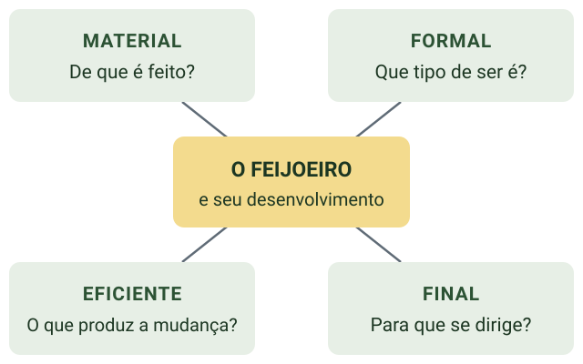
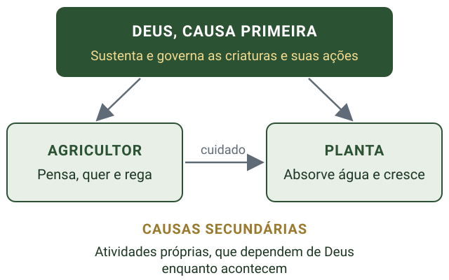
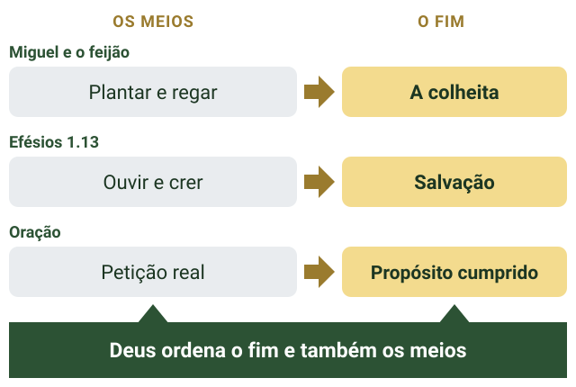
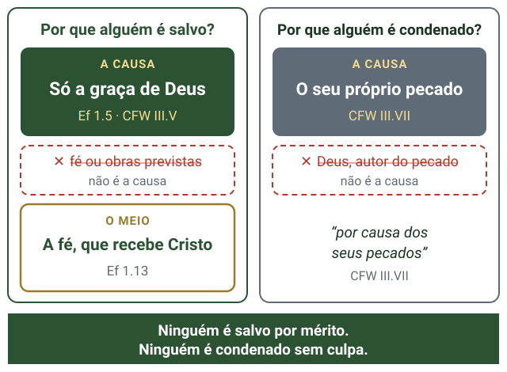

## 1. Miguel planta: de que depende uma colheita

Na [Parte 1](../aula-03-parte-1/) lemos Efésios 1.3-14 e as definições do Breve Catecismo: o [[decreto]] é o propósito eterno de Deus; a [[providencia|providência]] é o modo como ele preserva e governa tudo; a [[predestinacao|predestinação]] é a escolha para a vida eterna dentro desse propósito. Lemos também Deuteronômio 29.29: o encoberto é do SENHOR, o revelado é nosso.

Ficaram perguntas no ar, e quase todas começam com "por quê?". Se Deus governa tudo, o que eu faço importa? Por que orar? Por que uns e não outros? Nesta aula aprendemos a fazer essas perguntas direito. Para isso, plantamos feijão.

### Por que o feijão cresceu?

Miguel separa alguns feijões para plantar no quintal. Quer colher alimento. Escolhe o lugar, prepara a terra, semeia. Nos dias seguintes volta ao canteiro, olha a umidade, rega e espera. Ele não consegue abrir a semente por dentro para fabricar raízes. Um dia aparece o broto.

Miguel olha e pensa:

> **Ela cresceu porque eu cuidei? Porque a semente estava viva? Porque Deus a sustentou?**

As respostas não precisam se excluir. Miguel realmente cuidou. A planta realmente cresceu. Água e luz tiveram papéis reais. E toda essa realidade depende de Deus. É uma mesma história com várias causas.

Duas palavras ajudam daqui em diante. **Efeito** é o resultado que queremos explicar. **Causa** é aquilo de que uma coisa depende para existir, mudar ou alcançar um fim.

### Explicar é fazer quatro perguntas

Desde os gregos, e na teologia dos que escreveram a nossa Confissão, explicar uma coisa é fazer quatro perguntas:

- **De que é feito?** É a causa *material*: a matéria que forma o corpo do feijoeiro.
- **Que tipo de ser é?** É a causa *formal*: aquilo que faz dele um feijoeiro vivo, e não uma pedra.
- **O que produz a mudança?** É a causa *eficiente*: quem age. A planta age ao absorver e crescer; Miguel age ao plantar e regar.
- **Para que se dirige?** É a causa *final*: o fim. Para a planta, desenvolver-se e dar fruto; para Miguel, colher alimento.

Guarde as perguntas; os nomes estão na revista. **"Por quê?" nunca é uma pergunta só.**

### Miguel pensa e escolhe

Miguel percebe que a terra está seca, lembra que quer cuidar da plantação, busca o regador e molha o canteiro. Ele **entende** (a terra precisa de água), **quer** (deseja cuidar da plantação), **decide** (escolhe regar naquele momento) e **age**. O fim que ele deseja o leva a escolher os meios.

A planta absorve água sem pensar. Miguel considera razões e decide. Os dois são criaturas e dependem de Deus, mas agem de modos diferentes. **Miguel não é a planta: ele entende, quer e decide.**

Ação livre, aqui, é ação voluntária: sai do entendimento e da vontade da pessoa, sem ser arrancada dela à força. Isso não quer dizer independência de Deus. E o trabalho de Miguel tem efeitos reais; ele responde pelo que faz.

### Deus e as causas secundárias

Deus é a **causa primeira**: as criaturas dependem dele para existir e para agir, e ele não depende delas. "Primeira" não quer dizer só que ele agiu lá no começo; quer dizer que tudo depende dele agora.

Miguel e a planta são [[causas-secundarias|causas secundárias]]: recebem de Deus o ser e as capacidades e dependem dele enquanto agem. Secundária não quer dizer de mentira. A planta cresce de verdade; Miguel rega de verdade.

A teologia chama isso de [[concurso]]: Deus sustenta e faz agir a criatura, e ela produz de verdade o seu efeito, do jeito dela.

**Não é metade Deus, metade criatura.** Não se divide o acontecimento em porcentagens. Não são dois agricultores disputando o mesmo regador. Mais atividade da planta não significa menos providência.

## 2. A Confissão: Deus governa por causas reais

A história de Miguel não é enfeite. É a linguagem que a nossa Confissão usa.

> "Desde toda a eternidade, Deus, pelo muito sábio e santo conselho da sua própria vontade, **ordenou livre e inalteravelmente tudo quanto acontece**, porém de modo que **nem Deus é o autor do pecado, nem violentada é a vontade da criatura, nem é tirada a liberdade ou contingência das causas secundárias**, antes estabelecidas."
>
> [[confissao-de-fe-de-westminster|Confissão de Fé de Westminster]] (CFW), III.I

A frase tem **uma afirmação e três limites**. Deus ordenou tudo o que acontece, porém:

1. ele não é autor do pecado;
2. não força a vontade de ninguém;
3. não anula as causas secundárias.

**Causas secundárias** são as pessoas, a natureza e os meios que Deus usa. Agem de verdade; Deus governa por meio delas, não no lugar delas. Miguel não foi forçado, e tanto ele quanto a planta são causas de verdade.

[[contingencia|Contingência]] é aquilo que, do nosso lado, poderia ter acontecido de outro jeito. O decreto não transforma o mundo numa máquina.

Um exemplo: Deus sustenta a nossa vida, e ainda assim comemos, dormimos e tomamos remédio, e o remédio age de verdade. Na salvação é igual: Efésios 1.13 mostrou que Deus salva por meio de ouvir o evangelho e crer.

> "Posto que, em relação à presciência e ao decreto de Deus, que é a **causa primária**, todas as coisas acontecem **imutável e infalivelmente**, contudo, pela mesma providência, Deus ordena que elas sucedam **conforme a natureza das causas secundárias**, necessárias, livre ou contingentemente."
>
> Confissão de Fé de Westminster, V.II

O propósito de Deus não falha: "imutável e infalivelmente". Mas as coisas não acontecem todas do mesmo jeito. Acontecem "conforme a natureza das causas secundárias": a planta como planta, Miguel como gente. O mesmo governo de Deus abrange modos diferentes de agir.

### Três modos de acontecer

| Modo | O que é | Na história |
|---|---|---|
| **Necessário** | Uma causa natural produz o seu efeito, dadas as condições. | A semente viva, com água e calor, germina. |
| **Livre** | Uma pessoa age porque quer. | Miguel decide regar. |
| **Contingente** | Algo que não precisava acontecer pela natureza das coisas. | Miguel foi plantar feijão e achou uma moeda na terra. |

Os três modos podem aparecer no mesmo dia, no mesmo canteiro. E os três estão debaixo da mesma providência.

### A moeda na terra

Ao preparar outro pedaço do canteiro, Miguel encontra uma moeda que alguém perdeu. Duas histórias se cruzam: alguém perdeu a moeda, e ela ficou na terra; Miguel foi plantar e cavou naquele lugar. Plantar feijão não exige achar moeda; ser moeda não exige ser achada por Miguel. Isso é contingência: do lado das criaturas, podia ter sido de outro jeito.

Aconteceu sem causa? Não: alguém perdeu a moeda, e Miguel cavou ali. Foi por acaso para Deus? Também não. Em relação ao decreto, o encontro é certo. Em relação ao plantio, continua contingente. São duas relações diferentes.

**Contingente não é sem causa nem fora da providência.** Se Deus decretou que algo aconteça, o decreto não falha. Isso não transforma o acontecimento em algo forçado pela natureza das coisas.

## 3. O futuro e os meios: por que trabalhar e orar

Se o decreto não falha, para que Miguel rega?

### O decreto inclui o cultivo

Antes de colher, Miguel não sabe o resultado. A incerteza é dele, não de Deus. O acontecimento não passa a ser decretado quando vira passado; nós é que passamos a saber o que aconteceu.

Então a colheita vem de qualquer jeito? Não é isso que a doutrina diz. A história que Deus ordenou tem uma sequência: Miguel quer cultivar, prepara e rega, a planta recebe e usa a água (junto com outras condições, que também participam do resultado) e então se desenvolve. Se Deus determinou o crescimento por meio daquele cultivo, a história determinada inclui o cultivo. O fim e o caminho pertencem à mesma providência.

> **Se Deus decretou a colheita pelo cultivo, o cultivo está no decreto.**

Dizer "Deus decretou a colheita por este cuidado" e depois querer a mesma colheita sem o cuidado é trocar a história.

Miguel não recebeu a tarefa de descobrir o decreto secreto. Recebeu a tarefa de cuidar da plantação. E se ele cuidar e a planta morrer? Pode investigar, aprender e melhorar. A perda, sozinha, não autoriza concluir que Deus o está punindo.

> "Na sua providência ordinária **Deus emprega meios**; todavia, ele é livre para operar **sem eles, sobre eles ou contra eles**, segundo o seu arbítrio."
>
> Confissão de Fé de Westminster, V.III

Deus poderia dar feijão a Miguel sem semente e sem rega; ele não depende de Miguel. Mas a liberdade de Deus para agir de outro modo não torna dispensáveis os meios que ele escolheu usar nesta história. Causas reais não excluem milagres, e milagres não dispensam o trabalho de todo dia.

### Por que orar e evangelizar?

*Se Deus já determinou...*

É o mesmo desenho três vezes. A colheita vem por plantar e regar. A salvação chega por ouvir o evangelho e crer (Ef 1.13). E a oração é um pedido de verdade, pelo qual Deus realiza o que quer. A Confissão diz que Deus "preordenou todos os meios" (CFW III.VI).

Então para que eu oro pelo meu pai, pela minha amiga? Pelo mesmo motivo por que Miguel rega. A sua oração e a sua palavra podem ser o meio que Deus usa. Elas não são ditas em vão.

Oramos porque Deus nos manda orar e responde. Evangelizamos porque o evangelho precisa ser anunciado e ouvido.

> **Desconhecer o decreto não é o mesmo que suspender a obediência.**

## 4. Da plantação à salvação: os porquês

Falamos de feijão, de trabalho e de oração. Agora a pergunta que nos trouxe até aqui: e a salvação?

### Monergismo e concurso

A história de Miguel explica como as criaturas agem debaixo da providência. Ela não explica, sozinha, como alguém nasce de novo. São duas perguntas:

| | A pergunta | A resposta |
|---|---|---|
| **Monergismo** | Quem produz a nova vida espiritual? | Só Deus: ele regenera o pecador. |
| **Concurso** | Como as criaturas agem? | De verdade, e em dependência de Deus. |

São perguntas diferentes, não explicações rivais. Veja [[monergismo]] e [[concurso]] no glossário.

Na regeneração, o pecador não produz com Deus o seu novo nascimento. Mas a pessoa renovada não fica sem agir: ela crê, ora, obedece. E essa atividade é fruto da graça.

**Uma pessoa não se converte como uma semente germina.** Para falar de conversão, precisamos falar de pecado, graça, vontade e fé.

### E quem se perde?

Até aqui falamos de quem é salvo. E quem se perde? Na aula passada alguém perguntou por Judas. A Confissão não foge do assunto:

> "Segundo o inescrutável conselho da sua própria vontade, pela qual ele concede ou recusa misericórdia, como lhe apraz, para a glória do seu soberano poder sobre as suas criaturas, o resto dos homens, para louvor da sua gloriosa justiça, foi Deus servido não contemplar e ordená-los para a desonra e ira **por causa dos seus pecados**."
>
> Confissão de Fé de Westminster, III.VII

Repare no fim: "por causa dos seus pecados". A Confissão não diz que Deus pôs maldade em alguém; diz que ele não concedeu uma misericórdia que não devia a ninguém e que julga com justiça. É o que a teologia chama de [[reprovacao|reprovação]].

### Não há simetria

As duas perguntas parecem iguais e têm respostas diferentes.

**Por que alguém é salvo?** A causa está só em Deus: ele escolheu "de sua mera e livre graça e amor, e não por previsão de fé, ou de boas obras" (CFW III.V; Ef 1.5). A fé aparece, mas em outro lugar: é o **meio** de receber Cristo (Ef 1.13), não o motivo da [[eleicao|eleição]].

**Por que alguém é condenado?** A causa está na pessoa: o seu próprio pecado (CFW III.VII). Deus não pôs maldade em ninguém; ele "a ninguém tenta" (Tg 1.13).

> **Ninguém é salvo por mérito. Ninguém é condenado sem culpa.**

Alguém vai pensar: se eu não consigo escolher o bem, como a culpa é minha? Lembre Miguel: ninguém age arrastado. Judas procurou os sacerdotes porque quis, e Jesus disse "ai daquele" (Lc 22.22). Não conseguir, aqui, é não querer.

### O que dizemos e onde paramos

| Cremos | Não cremos | Não nos pronunciamos |
|---|---|---|
| Deus ordenou tudo o que acontece | Que Deus escolheu por prever fé ou obras | Por que este e não aquele |
| As criaturas agem de verdade | Que Deus é o autor do pecado | Quem são os eleitos |
| A eleição é só por graça, em Cristo | Que alguém é forçado contra a vontade | O destino de cada pessoa |
| A condenação é por causa do pecado | Que os meios são dispensáveis | Como Deus governa o ato mau sem pecar |
| *CFW III.I, V, VII; V.II* | *CFW III.I, II, V, VI* | *"do SENHOR" · Dt 29.29* |

A primeira coluna é o que a Confissão afirma. A segunda linha dela é a história de Miguel: causas secundárias reais.

A segunda coluna é o que a Confissão nega com todas as letras. **Muita gente rejeita a predestinação pensando que ela é esta coluna. Não é.**

Na terceira coluna a igreja para. Também gostaríamos de saber por que este e não aquele. A Bíblia não diz. A Confissão fala em "inescrutável conselho". Paulo chega a esse ponto em Romanos 11.33 e não explica; ele adora.

Isso vale para pessoas. Não sabemos o destino de quem você perdeu, e a Bíblia não dá licença para dizer. Sabemos quem é o juiz: o mesmo Deus que não poupou o próprio Filho. No lugar do que não sabemos, ficamos com o que sabemos: quem Deus é e o que ele prometeu.

## 5. Para a vida: trabalhar confiando

Nesta aula apareceram palavras difíceis: causa primeira, causa secundária, contingência. Ninguém precisa dominar todas para crer direito. E essa ideia não é nova.

> "Preferia que [os nomes] estivessem sepultos, para que constasse apenas que **há um único Deus, Pai e Filho e Espírito Santo** [...] e, no entanto, que o Filho não seja o Pai ou o Espírito o Filho, mas que fossem distintos por certa propriedade."
>
> João Calvino, *A instituição da religião cristã*, I.xiii.5, sobre os termos da Trindade

"Os nomes" são os termos técnicos da doutrina da Trindade: pessoa, substância, essência. Em outras palavras, Calvino abriria mão das palavras difíceis, desde que todos confessassem três coisas: há um só Deus; o Pai, o Filho e o Espírito Santo são esse Deus; e um não é o outro.

> "E não nos envergonhemos de ignorar algo, se nisso há uma **ignorância douta**."
>
> João Calvino, *A instituição da religião cristã*, III.xxi.2, sobre a predestinação

Com a predestinação é igual. Se você esquecer os termos, guarde isto: **Deus é justo, Deus é bom, Deus nos amou em Cristo, nada está fora do propósito dele, e o que eu faço importa.** Há uma ignorância que é sábia: parar onde Deus parou de falar.

### A promessa

> "Todo aquele que o Pai me dá, esse virá a mim; e **o que vem a mim, de modo nenhum o lançarei fora**."
>
> João 6.37, Almeida Revista e Atualizada

Quem pergunta com temor "e se eu não for escolhido?" normalmente não está fugindo de Cristo; está com medo de perdê-lo. A resposta não está em descobrir um decreto oculto, mas nesta promessa. Você não precisa descobrir antes que é eleito para vir a Cristo. O evangelho chama você a confiar nele.

### Para guardar

- **Decreto:** o propósito eterno de Deus, segundo o conselho de sua vontade.
- **Predestinação:** o destino eterno dentro do decreto; em Efésios, a eleição para a vida em Cristo.
- **Providência:** o agir santo, sábio e poderoso de Deus para preservar e governar a criação. É na criação e na providência que Deus *executa* o decreto (Breve Catecismo, resposta 8).

Miguel não precisa escolher entre trabalhar e confiar. **Ele trabalha confiando:** os atos dele importam, e a história inteira está debaixo da providência. O mesmo vale para a sua oração, o seu estudo, o seu trabalho e a sua fé.

Podemos conhecer de verdade sem compreender tudo. Respondemos o que dá para responder e não inventamos o que Deus não revelou.

### Leitura final

> "nos predestinou para ele, para a adoção de filhos, **por meio de Jesus Cristo**, segundo o beneplácito de sua vontade, **para louvor da glória de sua graça**, que ele nos concedeu gratuitamente **no Amado**"
>
> Efésios 1.5-6

---

## Para aprofundar

*Daqui em diante, o conteúdo **vai além do que foi dito em sala**.* É material para quem quiser estudar mais: o exemplo de Jonas, que a turma trouxe; um texto mais pastoral sobre como viver esta doutrina, também a pedido da turma; as quatro perguntas aplicadas a Efésios 1; perguntas frequentes; e onde consultar.

### Da turma: o exemplo de Jonas

Na conversa em sala, a turma lembrou de Jonas: no fim, a vontade de Deus prevaleceu. Uma cidade inteira se arrependeu por meio de um profeta que não queria pregar, e esse profeta continuou responsável pelos seus erros. O exemplo é muito bom, porque o livro de Jonas mostra, em quatro capítulos curtos, quase tudo o que vimos com Miguel.

**O propósito de Deus não falhou.** Deus manda Jonas a Nínive. Jonas se levanta, mas para fugir "da presença do SENHOR", na direção oposta (Jn 1.3). Três capítulos depois, Nínive ouviu a mensagem, creu em Deus e se converteu do seu mau caminho (Jn 3.5, 10). A fuga do profeta não tirou a história das mãos de Deus. Jonas mesmo confessa, de dentro do peixe: "Ao SENHOR pertence a salvação!" (Jn 2.9).

**Deus governou por meios.** Repare em quantas causas secundárias aparecem. O SENHOR lança um forte vento sobre o mar (1.4); os marinheiros lançam sortes, e a sorte cai sobre Jonas (1.7); o SENHOR "deparou" um grande peixe (1.17); depois faz nascer uma planta, envia um verme e um vento quente (4.6-8). Vento, sorte, peixe, planta e verme: a natureza, o que nos parece acaso e as decisões das pessoas, tudo debaixo da mesma providência. São os três modos de acontecer (necessário, livre e contingente) no mesmo livro.

E o meio principal foi o mais comum de todos: **a pregação**. Deus não converteu Nínive com uma voz do céu. Mandou um pregador, pela segunda vez (3.1), e a cidade creu ao ouvir. Jesus diz que os ninivitas "se arrependeram com a pregação de Jonas" (Mt 12.41). É o desenho da aula: Deus ordena o fim *e* os meios. Ele é livre para agir "sem eles, sobre eles ou contra eles" (CFW V.III), e no caso de Jonas fez as duas coisas: usou o meio comum, a pregação, e agiu de modo extraordinário, com o peixe, para levar o pregador até lá.

**Jonas não foi um robô.** Em nenhum momento o texto mostra um Jonas sem vontade. Ele decide fugir, paga a passagem, desce ao navio, dorme. Depois ora, obedece, prega. E no fim fica irado. Deus não o trata como uma peça: conversa com ele, pergunta ("É razoável essa tua ira?", 4.4), ensina com a planta. A vontade de Jonas não foi "violentada" (CFW III.I). Deus o trouxe de volta por meios, inclusive duros, e Jonas foi a Nínive andando com as próprias pernas.

**Jonas continuou responsável.** Aqui está o ponto que a turma percebeu. O bom resultado não transformou a desobediência de Jonas em obediência. A fuga foi pecado, e ele mesmo reconhece a culpa no navio: "por minha causa, vos sobreveio esta grande tempestade" (1.12). E o livro termina com o profeta sendo repreendido, não elogiado: Nínive está salva, e Jonas está zangado porque Deus teve misericórdia. Deus usou a pregação de um homem contrariado, mas não aprovou a contrariedade dele.

Vale para Jonas o que vimos sobre Judas na [Parte 1](../aula-03-parte-1/) e o que José disse aos irmãos ("vós, na verdade, intentastes o mal contra mim; porém Deus o tornou em bem", Gn 50.20): Deus cumpre o seu propósito por meio das ações das pessoas, e cada um responde pelo que quis e fez. Há uma diferença importante entre os casos. Judas agiu por cobiça e não se voltou para Cristo. Jonas é um servo de Deus que pecou, foi disciplinado e restaurado. A providência que governou os dois é a mesma; o trato de Deus com cada um, não.

**E o "Deus se arrependeu"?** O texto diz que Deus "se arrependeu do mal que tinha dito lhes faria e não o fez" (Jn 3.10). Isso não quer dizer que Deus foi pego de surpresa ou mudou de plano. A Escritura afirma que Deus "não é homem, para que minta; nem filho de homem, para que se arrependa" (Nm 23.19). A Bíblia usa a nossa linguagem para descrever a mudança no modo como Deus trata as pessoas quando elas mudam: a cidade que estava debaixo de ameaça passa a receber misericórdia. O próprio Deus explica esse princípio em Jeremias 18.7-8: se a nação ameaçada se converter, ele não traz o mal anunciado. O aviso "ainda quarenta dias" (3.4) era, ele mesmo, um **meio**: Deus ameaçou para que se arrependessem. E Jonas sabia disso desde o começo. Foi por isso que fugiu: "sabia que és Deus clemente, e misericordioso, e tardio em irar-se, e grande em benignidade" (4.2).

**O que Jonas ensina sobre o nosso coração.** O livro termina com uma pergunta de Deus, sem resposta do profeta: "e não hei de eu ter compaixão da grande cidade de Nínive?" (4.11). Jonas conhecia a doutrina certa sobre Deus e não gostava dela quando a misericórdia ia para os inimigos. É um aviso para quem estuda a soberania de Deus: dá para entender tudo isto e ainda assim ter um coração pequeno. A doutrina da eleição deveria nos deixar mais parecidos com o Deus que tem compaixão, e não com o profeta sentado fora da cidade, esperando para ver o que ia acontecer.

Três coisas, então, o exemplo de Jonas confirma:

1. o propósito de Deus se cumpre, e a nossa resistência não o derruba;
2. ele se cumpre por meios reais, e o principal deles é a Palavra pregada, mesmo por gente fraca;
3. ser usado por Deus não é o mesmo que estar certo: continuamos responsáveis pelo que queremos e fazemos.

### Como viver esta doutrina

A turma pediu um tom mais pastoral: tudo bem entender os termos, mas o que isso muda numa segunda-feira? A própria Confissão trata o assunto assim. Ela pede que esta doutrina seja ensinada "com especial prudência e cuidado" e diz para que ela serve: para que os que obedecem ao evangelho tenham motivo de louvor, reverência e admiração de Deus, e de "humildade, diligência e abundante consolação" (CFW III.VIII). Uma doutrina que só gera discussão, medo ou frieza está sendo mal usada. Algumas situações concretas:

**Quando você olha para a própria fé.** Você crê em Cristo. Por quê? A resposta de Efésios 1 é que Deus amou você antes de você fazer qualquer coisa. Isso tira o chão do orgulho: não cremos porque somos mais espertos, mais sensíveis ou melhores do que quem não crê. E tira também o chão do desespero: se a salvação não começou em você, ela não depende de você estar num dia bom. A reação que o texto ensina é a de Paulo: "Bendito o Deus e Pai de nosso Senhor Jesus Cristo" (Ef 1.3). Gratidão e humildade andam juntas.

**Quando você tem medo de não ser eleito.** Esse medo aparece mais em gente séria do que em gente descuidada. A resposta não é procurar dentro de si um sinal secreto, nem tentar espiar o decreto. É olhar para onde Deus mandou olhar: para Cristo e para a promessa. "O que vem a mim, de modo nenhum o lançarei fora" (Jo 6.37). Ninguém jamais veio a Cristo e ouviu "você não estava na lista". A Escritura fala em confirmar a vocação e a eleição (2Pe 1.10), e o caminho que ela indica é o comum: ouvir a Palavra, crer, orar, participar da igreja, lutar contra o pecado. A certeza cresce aí, aos poucos, e não numa descoberta de uma hora para outra. Se a dúvida aperta, converse com o pastor ou com um presbítero. É para isso que eles estão aí.

**Quando você precisa decidir.** Trabalho, faculdade, namoro, mudança de cidade. Muita gente trava com medo de "errar o plano de Deus", como se ele fosse um alvo escondido que a gente precisa adivinhar. Miguel não recebeu a tarefa de descobrir o decreto secreto; recebeu a tarefa de cuidar da plantação. O que Deus revelou está na Escritura: é ali que se aprende o que é certo e errado, sábio e tolo. Dentro disso, ore, peça conselho, pense e decida. Você decide de verdade, responde pela decisão, e não está sozinho nela: a história inteira, incluindo as suas escolhas imperfeitas, está debaixo da providência de um Pai. Isso é o contrário de paralisia.

**Quando você trabalha, estuda e se esforça.** "Se Deus já determinou, para que me esforçar?" Pelo mesmo motivo por que Miguel rega. O esforço é o meio. Paulo junta as duas coisas sem constrangimento: "desenvolvei a vossa salvação com temor e tremor; porque Deus é quem efetua em vós tanto o querer como o realizar, segundo a sua boa vontade" (Fp 2.12-13). A soberania de Deus não é motivo para fazer menos. É motivo para fazer sem desespero: o resultado não depende só de você, e o seu trabalho não é em vão.

**Quando você sofre.** Aqui é preciso cuidado, porque esta doutrina pode ser dita de um jeito que machuca. Crer na providência não é fingir que o mal não doeu, nem chamar de bom o que é mau. José disse aos irmãos, com todas as letras: "intentastes o mal contra mim". Só depois acrescentou: "porém Deus o tornou em bem" (Gn 50.20). Também não é concluir que todo sofrimento é castigo: se a planta de Miguel morrer, isso sozinho não autoriza dizer que Deus o está punindo. O que a providência garante é outra coisa: o seu sofrimento não é um acidente fora do controle de Deus, e não é a última palavra. "Sabemos que todas as coisas cooperam para o bem daqueles que amam a Deus" (Rm 8.28) foi escrito no mesmo capítulo que fala de gemidos, tribulação e angústia. E a prova de que Deus é por nós não está em entendermos o que ele está fazendo, mas na cruz: "Aquele que não poupou o seu próprio Filho, antes, por todos nós o entregou, porventura, não nos dará graciosamente com ele todas as coisas?" (Rm 8.32). Você pode chorar, perguntar "por quê?" e orar como os salmistas. E, quando for a vez de consolar alguém, chegue perto e ouça antes de explicar. Romanos 8.28 é verdade, mas não é a primeira coisa a se dizer num velório.

**Quando você ora por alguém que não crê.** Se a conversão dependesse só da pessoa, a oração seria um pedido para Deus fazer algo que ele não pode fazer. É porque Deus muda corações que faz sentido pedir. A sua oração pelo seu pai, pela sua amiga, pelo seu colega é um pedido de verdade e pode ser o meio que Deus vai usar. O mesmo vale para a sua palavra. Você não sabe quem são os eleitos, e não precisa saber: o evangelho é para ser anunciado a todos. Jonas pregou uma frase, de má vontade, e uma cidade se arrependeu. O poder nunca esteve no pregador. Isso tira dos nossos ombros o peso de "convencer" alguém, e nos deixa com a parte que é nossa: orar, amar e falar de Cristo.

**Quando alguém que você ama se afastou da igreja.** Não cabe a nós dizer se a pessoa nunca creu ou se vai voltar. Enquanto ela vive, os meios continuam valendo: orar, procurar, manter a amizade, falar de Cristo quando houver abertura. Ninguém está fora do alcance de Deus. Paulo perseguia a igreja.

**Quando alguém que você ama morreu sem dar sinal de fé.** Esta é a mais difícil, e merece uma resposta honesta. Não sabemos o destino de pessoa nenhuma; isso está na terceira coluna, a do que é "do SENHOR" (Dt 29.29). Não podemos afirmar a condenação de alguém, porque não vemos o coração nem os últimos momentos de uma vida. E também não devemos prometer o que a Bíblia não promete. O que sabemos é quem é o juiz: ele é justo, é bom, e é o mesmo que entregou o Filho. Ele não vai errar, nem para mais nem para menos. Se essa é a sua dor, não a carregue sozinho: procure o pastor ou alguém de confiança na igreja para conversar com calma.

**Quando você conversa sobre o assunto.** Com um amigo de outra igreja, com um parente, num grupo. Lembre da segunda coluna do quadro: muita gente rejeita a predestinação pensando que ela ensina que Deus é autor do pecado, que somos robôs ou que não adianta orar. Antes de discutir, vale perguntar o que a pessoa entende pela palavra. E lembre de Jonas: dá para estar certo sobre Deus e errado no coração. Esta doutrina foi dada para adoração e consolo. Quem a usa para ganhar discussão ou para se sentir superior ainda não a entendeu.

Um resumo antigo ajuda a guardar. O Catecismo de Heidelberg, confissão de fé de outras igrejas reformadas (faz parte das [[tres-formas-de-unidade|Três Formas de Unidade]], e não das normas da IPB), pergunta para que serve saber da providência de Deus. A resposta, em paráfrase: para sermos **pacientes na adversidade, gratos na prosperidade e confiantes quanto ao futuro**, certos de que nada nos pode separar do amor do nosso Pai (pergunta 28).

### As quatro perguntas em Efésios 1

As quatro perguntas que fizemos sobre o feijoeiro podem ser feitas sobre a salvação, e Efésios 1 responde às quatro. É assim que Calvino lê o texto:

| A pergunta | A resposta de Efésios 1 | Versículos |
|---|---|---|
| **De onde vem?** | Da boa vontade de Deus, da sua graça e do seu amor, e não de algo que ele viu em nós. | 5, 9, 11 |
| **Por meio de quem?** | De Cristo: fomos escolhidos "nele" e temos a redenção "pelo seu sangue". | 4, 7 |
| **Como chega até mim?** | Pelo evangelho ouvido e crido. A fé é o meio, não o mérito. | 13 |
| **Para quê?** | Para o louvor da glória da sua graça. | 6, 12, 14 |

> "Mencionam-se aqui três causas da nossa salvação, e uma quarta é acrescentada logo depois. A causa eficiente é o beneplácito da vontade de Deus; a causa material é Jesus Cristo; e a causa final é o louvor da glória da sua graça."
>
> João Calvino, comentário a Efésios 1.5-6 (tradução nossa)

A quarta, para Calvino, é a pregação do evangelho recebida pela fé. Os nomes das causas não se encaixam na salvação exatamente como no feijoeiro, e por isso é melhor ficar com as perguntas. Duas observações:

- **A fé está na terceira pergunta, não na primeira.** Ela é o meio de receber, como a rega de Miguel é meio da colheita. Deus não nos escolheu porque iríamos crer; cremos porque ele nos escolheu e nos chamou.
- **Nenhuma das quatro respostas está em nós.** E nenhuma responde "por que este e não aquele?". Essa pergunta fica onde a Confissão a deixou: no "inescrutável conselho" de Deus.

### Perguntas frequentes

As perguntas sobre Judas, sobre a fé prevista e sobre a justiça da eleição estão no "Para aprofundar" da [Parte 1](../aula-03-parte-1/). Aqui vão as outras.

**Então somos robôs?** Não. A Confissão diz que a vontade da criatura não é violentada (III.I). Miguel entende, quer, decide e age, e Jonas também. Ter certeza de que o propósito de Deus se cumpre não é o mesmo que ser coagido. Ninguém crê nem peca arrastado.

**Posso dizer que Deus "só permitiu"?** Depende do que se quer dizer. Se "permitir" significa que Deus fica olhando de fora, como um espectador, não: a providência conserva as criaturas, age na ação delas e governa. Sobre o pecado, a Confissão fala, sim, de permissão, mas de uma permissão que Deus limita, ordena e governa para os seus santos fins, e em que a maldade procede só da criatura (CFW V.IV).

**Deus é o autor do pecado?** A Confissão nega isso expressamente (III.I e V.IV), e Tiago também: "Deus não pode ser tentado pelo mal e ele mesmo a ninguém tenta" (Tg 1.13). É preciso ser honesto: a história da planta ajuda a entender dependência e meios, mas não explica *como* Deus governa um ato mau sem participar da maldade. Esse ponto está na terceira coluna. Sabemos que é assim (Gn 50.20; At 2.23); não sabemos explicar o como.

**Se Deus decretou, por que orar?** Porque Deus ordenou os meios junto com o fim. A oração é um pedido de verdade e um dos meios pelos quais ele realiza o que quer. Jesus, que conhecia o propósito do Pai melhor do que ninguém, passava noites em oração.

**Por que Deus escolhe uns e não outros?** Não sabemos, e a Confissão não diz: fala em "inescrutável conselho" e "como lhe apraz" (III.VII). Sabemos o que *não* é o motivo: nenhum mérito, fé ou obra prevista (III.V). A resposta não satisfaz por inteiro, e não é preciso fingir que satisfaz. Paulo chega a esse ponto e adora: "Ó profundidade da riqueza, tanto da sabedoria como do conhecimento de Deus!" (Rm 11.33).

**E quem nunca ouviu o evangelho?** Efésios 1.13 liga a fé a ouvir, e Romanos 10.14 pergunta como crerão naquele de quem nada ouviram. A Confissão afirma que não há salvação fora de Cristo (X.IV). A conclusão prática da Escritura é a missão: se a fé vem por ouvir, alguém precisa ir e falar. O assunto é sério e não se resolve em duas linhas.

**Preciso entender tudo isso para crer direito?** Não. Há frases que não podem faltar, e há um vocabulário que as protege de leituras erradas. Quem guarda que Deus é justo, bom e amoroso, que tudo está debaixo do seu propósito e que o que fazemos importa, crê direito. O estudo firma o que já se crê. Calvino, que falou em "ignorância douta", rejeita no mesmo capítulo o extremo oposto: o de quem prefere nem saber o que Deus revelou.

### Vocabulário desta aula

Os termos principais têm verbete no glossário: [[causas-secundarias|causas secundárias]] (e causa primeira), [[concurso]], [[contingencia|contingência]], [[monergismo]] e [[reprovacao|reprovação]]. Os demais, em uma frase:

| Termo | Em uma frase |
|---|---|
| Causa | Aquilo de que algo depende para existir, mudar ou alcançar um fim. |
| Efeito | O resultado que queremos explicar. |
| Causa material | De que a coisa é feita. |
| Causa formal | O que faz dela esse tipo de ser. |
| Causa eficiente | Quem age e produz a mudança. |
| Causa final | O fim para o qual a atividade se dirige. |
| Necessário, livre, contingente | Três modos de as causas criadas agirem (CFW V.II). |
| Meios | Aquilo por que um resultado se realiza. |

Um cuidado: a distinção entre causa primeira e causas secundárias trata de *quem age*. Não se soma com a lista das quatro perguntas, como se Deus fosse a matéria ou a forma da planta.

### Onde consultar

Estes parágrafos completam o quadro da Parte 1:

| Assunto | Onde está | Em uma frase |
|---|---|---|
| Decreto e seus limites | CFW III.I | Deus ordenou tudo, sem ser autor do pecado, sem forçar a vontade e sem anular as causas secundárias. |
| Causas secundárias | CFW V.II | Tudo acontece infalivelmente e, ao mesmo tempo, conforme a natureza de cada causa. |
| Meios | CFW III.VI e V.III | Deus preordenou os meios e normalmente os usa, sem depender deles. |
| Providência e pecado | CFW V.IV | Deus governa até o pecado, sem ser autor nem aprovador dele. |
| Eleição | CFW III.V | Só por graça, em Cristo, e não por fé ou obras previstas. |
| Reprovação | CFW III.VII | Os demais são condenados por causa dos seus pecados. |
| Como tratar o tema | CFW III.VIII | Com prudência, para louvor, humildade, diligência e consolo. |
| Liberdade da vontade | CFW IX | A vontade é real e não é forçada, mas precisa ser renovada para querer o bem. |
| Chamado eficaz | CFW X.I-II; BCW 31 | Deus renova a vontade, e a pessoa vem a Cristo livremente. |
| Regeneração e meios | [[canones-de-dort\|Cânones de Dort]] III/IV.12, 16 e 17 | A graça não trata as pessoas como objetos sem vontade nem dispensa os meios. Não é norma da IPB, mas de outras igrejas reformadas. |

### Para ir além

- **A revista "Causas e providência"** foi preparada para acompanhar esta aula e é distribuída aqui no portal: está em "Material da aula", no fim desta página. Ela conta a história de Miguel por inteiro e traz o que ficou fora da sala: potência e ato, a diferença entre conservação, concurso e governo, e as hipóteses de Miguel sobre o futuro.
- **O livro de Jonas** se lê em quinze minutos. Leia de uma vez, anotando cada verbo em que Deus é o sujeito.
- **Os livros indicados na [Parte 1](../aula-03-parte-1/)** (Packer, Sproul e Tourinho) valem para as duas partes. Para a pergunta "por que orar e evangelizar?", comece por Packer.
